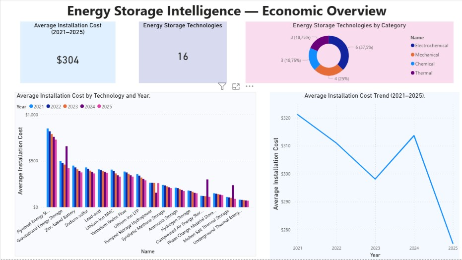
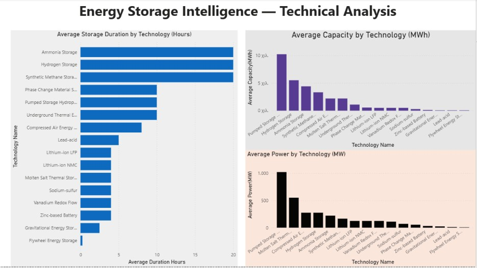
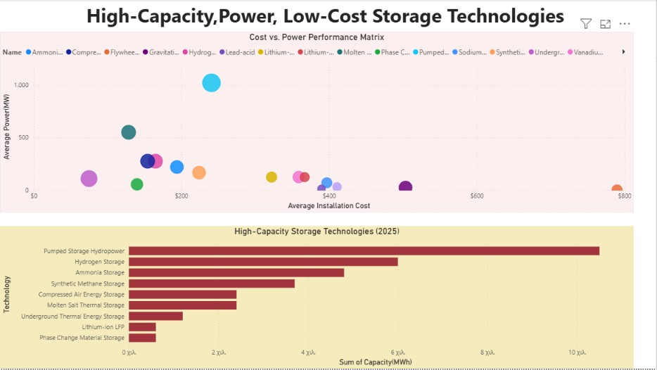

# ⚡ Energy Storage Intelligence (2021–2025)

<p align="center">
  
  
  
  
</p>

<p align="center">
  <b>Relational database project built in Microsoft SQL Server to analyze economic and technical metrics across 16 energy storage technologies (2021–2025).</b>
</p>

---

## 📌 Executive Summary

**Energy Storage Intelligence** is a relational database project built in **Microsoft SQL Server**. It models, structures, and analyzes economic and technical data across 16 distinct energy storage systems over a 5-year period (**2021–2025**).

The project includes a relational schema, performance indexes, an analytical view, custom stored procedures, and a suite of analytical T-SQL queries.

---

## 🗄️ Database Architecture & Schema

The database relies on a structured relational design consisting of four core tables:

| Table | Type | Primary Key | Description |
| :--- | :--- | :--- | :--- |
| **`Categories`** | Dimension | `CategoryID` | Broad technical classification (*Electrochemical, Mechanical, Thermal, Chemical*). |
| **`Technologies`** | Dimension | `TechnologyID` | Specific energy storage solutions linked to primary categories. |
| **`EconomicData`** | Fact (Time-Series) | `EconomicDataID` | Financial indicators per year (*InstallationCost, AnnualOperatingMaintenanceCost, LevelizedStorageCost*). |
| **`TechnicalData`** | Fact (Time-Series) | `TechnicalDataID` | Performance metrics per year (*CapacityMWh, PowerMW, LifetimeYears, DurationHours*). |

---

## 🛠️ Key Technical Features

* **Relational Integrity**: Explicit Primary & Foreign Key constraints linking categories, technologies, and time-series data.
* **Performance Indexing**: Implemented non-clustered indexes on selected time-series and analytical columns to support query performance and provide a foundation for future optimization as the dataset grows.
* **Unified Analytical View (`vw_EnergyStorageFullAnalysis`)**: Centralized interface combining financial and technical metrics for reporting.
* **Custom Stored Procedures**: 
  * `Economics_Per_Year`: Retrieves financial data for a specified target year.
  * `Economics_Exists_Per_Year`: Checks data availability for a given year using conditional logic (`IF...ELSE`).
* **10 Analytical Queries**:
  * Multi-table `JOIN`s and `GROUP BY / HAVING` aggregations.
  * Defensive calculation logic using `NULLIF` (e.g., *Power-to-Capacity Ratio*).
  * Subquery filtration (`WHERE EXISTS`) and distinct domain grouping.
  * **Self-JOIN YoY Analysis**: Calculates technology cost reductions between 2021 and 2025.

---
## 📊 Power BI Dashboard

### 1. Market & Economic Overview


### 2. Technical Performance & Trade-offs


### 3. Cost-Efficiency & Technology Comparison


## 📂 Repository Structure

```text
Energy-Storage-Intelligence/
│
├── SQL-CREATE_TABLES.sql
├── SQL-INSERT_DATA.sql
├── SQLQUERIES.sql
├── SQL-VIEWS-INDEXES-STORED_PROCEDURES.sql
├── Energy_Storage_Intelligence.pbix
├── page1.png.jpg
├── page2.jpg
├── page3.jpg
└── README.md


